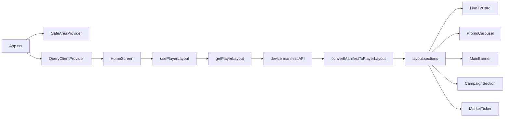

# Project Overview

## Purpose and scope

tripMonitor is a single-screen mobile/embedded display application for presenting dynamic content in a travel-and-commerce environment. The app does not implement multi-page app navigation; instead, it loads a device manifest from a backend and renders the layout into a single dashboard optimized for display screens.

The implementation is centered on a content orchestration pattern:

1. Fetch the device manifest
2. Map the manifest schedule to UI sections
3. Render each section in a fixed display layout
4. Refresh content periodically and continue driving the screen

## Main features

- Dynamic media placement using a device manifest API
- Video panel with fullscreen interaction
- Repeating banner/carousel modules for promotional content
- Campaign prize wheel
- Market ticker with static fallback promotional messages
- Custom Persian typography and RTL visual layout
- Background polling for content refreshes

## Technology stack

- Expo + React Native: app runtime and native packaging
- TypeScript: static typing
- TanStack Query (`@tanstack/react-query`): API loading and polling
- Expo Video (`expo-video`): native video playback
- `react-native-svg`: SVG/pie-chart style prize wheel drawing
- `react-native-reanimated-carousel`: included in dependencies but not the active rendering engine in the current implementation
- `react-native-safe-area-context`: safe-area wrappers
- Expo Font: custom font loading

## Application architecture

The app root is `App.tsx`. It loads the custom fonts and wraps the app in:

- `SafeAreaProvider`
- `QueryClientProvider`
- `HomeScreen`

`HomeScreen` is the only real screen in the app. It calls `usePlayerLayout()`, which uses TanStack Query to request a manifest via `getPlayerLayout()` in `services/player.ts`.

After fetching the payload, the backend response is converted from a device-manifest format into the UI schema defined in `types/player.ts`. The resulting `layout.sections` drives the screen composition.

## Directory and file responsibilities

- `App.tsx`: app bootstrap and font initialization
- `index.ts`: Expo root registration
- `screens/HomeScreen.tsx`: main dashboard composition
- `services/player.ts`: backend manifest fetch and conversion logic
- `services/tvService.ts`: IPTV sports stream discovery utility
- `hooks/usePlayerLayout.ts`: TanStack Query hook for manifest polling
- `components/banner/MainBanner.tsx`: large image banner
- `components/promo/PromoCarousel.tsx`: horizontal slide carousel
- `components/live-tv/LiveTVCard.tsx`: video panel with fullscreen capability
- `components/campaign/CampaignSection.tsx`: prize wheel interaction
- `components/news/MarketTicker.tsx`: market ticker and fallback promo feed
- `components/modules/AppText.tsx`: typography wrapper with RTL and weight selection
- `types/player.ts`: manifest/UI data contract
- `assets/fonts`: Vazirmatn font assets

## Navigation and screen structure

The app is intentionally a single-screen, signage-oriented dashboard.

There is no Expo Router structure in `src/app`, and no route stack by screen. The screen composition is built directly in `HomeScreen.tsx` and includes:

- top row: two side carousels + central video panel
- bottom row: main banner + campaign card
- quick actions row at the bottom of the screen
- fixed market ticker at the top

The `Placement` strings are defined in `types/player.ts` as:

- `top-left`
- `top-right`
- `bottom-left`
- `bottom-right`

Those placements are transformed into a layout structure before rendering.

## State management

The app uses a light state model:

- `@tanstack/react-query` handles remote data freshness and polling
- local component state handles animation, fullscreen toggles, and carousel index tracking
- no global store, Context API, or Redux layer is present

This suits the signage/dashboard pattern, where most content is server-driven and ephemeral.

## API communication and backend integration

The project connects to several external endpoints:

- Device manifest API: `http://46.34.163.41:8000/api/v1/device/manifest`
- Market board API: `https://tindex.app/api/public/boards`
- IPTV source metadata: `https://iptv-org.github.io/api/channels.json`
- IPTV stream metadata: `https://iptv-org.github.io/api/streams.json`

The primary data source is the device manifest. It contains:

- `media`: images/videos metadata
- `schedule`: placement, timing, and ordering
- `layout.type`: display layout type

The backend data is transformed from manifest records into the UI-friendly media model used by the screen components.

## Authentication and persistence

The current implementation does not include a user auth flow.

Instead, the app relies on:

- a hardcoded device token for the manifest endpoint
- a placeholder authorization string for the market API
- no persistent app storage and no user session management

This is a deployment requirement for a kiosk-style or display terminal rather than a consumer app.

## Native functionality and platform-specific dependencies

- `expo-video`: video playback and fullscreen support
- `expo-font`: custom typography
- `react-native-svg`: the prize wheel drawing
- `react-native-safe-area-context`: safe-area handling
- Android package name: `com.daniuf.tripMonitor`

The app is configured with `orientation: "portrait"` in `app.json`, which matters for display deployment and should be considered when targeting a physical screen.

## Known architectural limitations

- There is no environment variable layer or production config file.
- There is no robust offline fallback for network failures.
- There is no real kiosk mode, startup persistence, or wake-lock handling.
- There is no Android TV or remote control input model.
- The backend URLs and tokens are not parameterized for environment-specific deployments.
- The project does not include a prebuilt EAS configuration.

These limitations matter for deployment planning and should be treated as real operational constraints rather than assumptions.
